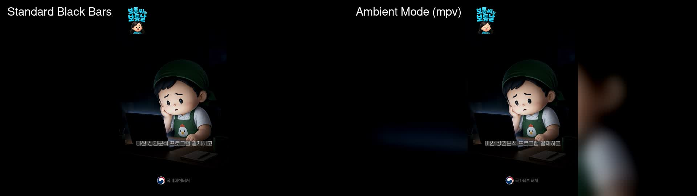

# mpv Ambient Mode for Windows

> **Out-of-the-box ambient lighting for vertical videos (YouTube Shorts, TikTok, Instagram Reels) on horizontal displays in mpv on Windows.**



---

## ✨ Features

- 🌟 **Native GPU Acceleration**: Uses `vo=gpu-next` and `border-background=blur` for silky smooth, low-overhead ambient border rendering on modern Windows GPUs (Direct3D 11 / Vulkan).
- 🎵 **Smart Auto-BGM for Silent Videos**: Automatically detects videos lacking an audio track (e.g. silent presentation slides or demo loops) and injects/loops background music from `bgm/` at a gentle 60% volume. Videos with narration/audio remain untouched.
- 🔁 **Recursive Folder Infinite Looping**: Native `directory-mode=recursive` and `loop-playlist=inf` automatically scans any folder and all its subfolders for video files and loops them continuously. Perfect for exhibitions, kiosks, digital signage, and store displays.
- 📺 **Zero Impact on 16:9 Videos**: Ambient borders automatically appear only on mismatched aspect ratios (e.g. 9:16 vertical shorts on 16:9 monitors) — standard landscape videos remain completely untouched.
- 📦 **Standalone Portable Release (No PowerShell Required)**: Environments blocking PowerShell can download the standalone pre-packaged portable zip directly from [Releases](https://github.com/kmsrepo/mpv-ambient-windows/releases). Unzip and run!
- ⚡ **One-Click Script Installation**: 1-line PowerShell script installs cleanly into `%APPDATA%\mpv` or existing portable directories.
- 🔄 **Safe Auto-Backup**: Automatically preserves and backs up any existing `mpv.conf` or `input.conf` before making changes.
- ⌨️ **Interactive Controls**: Press `b` to toggle blur on/off on the fly, or adjust blur radius dynamically with hotkeys.

---

## 📦 Standalone Portable Download (No PowerShell / Zero Setup)

If your environment **rejects or blocks PowerShell** (corporate laptops, kiosk computers, restricted user accounts):

1. Go to **[Releases](https://github.com/kmsrepo/mpv-ambient-windows/releases)** and download **`mpv-ambient-portable-windows-x64.zip`**.
2. Unzip anywhere (e.g., Desktop or USB stick).
3. Put video files (or nested subfolders) into the `videos` folder and double-click **`PLAY_VIDEOS_FOLDER.bat`**.
   * *Or simply drag and drop ANY folder directly onto `PLAY_VIDEOS_FOLDER.bat` or `mpv.exe`!*

---

## 🚀 Quick Install via PowerShell (If PowerShell is allowed)

Open PowerShell on your Windows PC and paste:

```powershell
irm https://raw.githubusercontent.com/kmsrepo/mpv-ambient-windows/main/install.ps1 | iex
```

*That's it! Open any vertical video with mpv to see the ambient blur effect.*

---

## 🛠️ Manual Installation

### Method A: Standard Windows Install (`%APPDATA%\mpv`)
If you installed mpv via Scoop, Chocolatey, Winget, or the Windows installer:

1. Press <kbd>Win</kbd> + <kbd>R</kbd>, type `%APPDATA%\mpv`, and hit <kbd>Enter</kbd> (create the folder if it does not exist).
2. Copy `mpv.conf` and `input.conf` from the [`portable_config/`](portable_config/) directory into `%APPDATA%\mpv\`.

### Method B: Portable mpv
If you use a portable mpv zip (e.g., from [zhongfly/mpv-winbuild](https://github.com/zhongfly/mpv-winbuild)):

1. Open your mpv folder where `mpv.exe` is located.
2. Copy the [`portable_config`](portable_config/) folder directly into the same folder as `mpv.exe`:
   ```
   mpv/
   ├── mpv.exe
   ├── d3dcompiler_43.dll
   └── portable_config/
       ├── mpv.conf
       └── input.conf
   ```

---

## 🎮 Keybindings (`input.conf`)

| Key | Action |
| :--- | :--- |
| <kbd>b</kbd> | **Toggle ambient mode**: Cycles between solid black bars and blurred ambient video |
| <kbd>Ctrl</kbd> + <kbd>[</kbd> | Decrease blur radius (sharper background) |
| <kbd>Ctrl</kbd> + <kbd>]</kbd> | Increase blur radius (smoother/softer background) |
| <kbd>Alt</kbd> + <kbd>b</kbd> | Toggle FFmpeg `lavfi` software ambient filter (fallback) |

---

## ⚙️ Configuration Reference (`mpv.conf`)

```ini
# Use modern GPU output driver
vo=gpu-next
gpu-api=auto
hwdec=auto-safe

# Fill window pillarbox borders with blurred video
border-background=blur

# Blur radius in pixels (default: 25)
background-blur-radius=25
```

### Optional: Software `lavfi` Fallback Profile
If your graphics driver or older mpv build does not support `vo=gpu-next`, you can use the built-in FFmpeg filter chain by uncommenting the fallback profile in `mpv.conf`:

```ini
[vertical-ambient-filter]
profile-cond=p["video-params/w"] and p["video-params/h"] and (p["video-params/w"] < p["video-params/h"])
profile-desc="FFmpeg lavfi ambient blur fallback"
vf-add="lavfi=[split[fg][bg];[bg]scale=1920:1080:force_original_aspect_ratio=increase,crop=1920:1080,boxblur=25:5,eq=brightness=-0.08[bgblur];[fg]scale=-1:1080[fgscaled];[bgblur][fgscaled]overlay=(W-w)/2:(H-h)/2]"
```

---

## 🇰🇷 한국어 안내 (Korean Guide)

### 특징
- **세로 쇼츠 앰비언트 블러**: 유튜브 쇼츠, 릴스, 틱톡 등의 9:16 세로 영상을 16:9 가로 모니터에서 재생할 때, 좌우의 칙칙한 검은색 필러박스를 영상 기반의 은은한 앰비언트 블러(Ambient Blur) 화면으로 채워줍니다.
- **하위 폴더 재귀 무한 반복**: `directory-mode=recursive` 및 `loop-playlist=inf` 설정이 기본 탑재되어 지정한 폴더 내의 모든 하위 폴더 및 영상 파일을 자동으로 스캔하여 무한 연속 재생합니다 (전시관, 팝업스토어, 키오스크 최적화).
- **GPU 가속**: 최신 mpv의 네이티브 GPU 가속(`vo=gpu-next`)을 활용하여 CPU 점유율 없이 가볍고 부드럽게 작동합니다.
- **가로 영상 무간섭**: 일반 16:9 가로 영상 재생 시에는 여백이 없으므로 전혀 영향을 주지 않습니다.

### 📦 PowerShell 사용 불가 환경 (무설치 포터블)
회사 보안 정책이나 키오스크 환경 등으로 **PowerShell 실행이 차단**된 경우:
1. **[Releases](https://github.com/kmsrepo/mpv-ambient-windows/releases)** 페이지에서 **`mpv-ambient-portable-windows-x64.zip`** 파일을 다운로드합니다.
2. 압축을 푼 뒤, 재생할 영상들이 담긴 폴더를 `PLAY_VIDEOS_FOLDER.bat`에 드래그&드롭하거나, `videos` 폴더에 영상을 넣고 `PLAY_VIDEOS_FOLDER.bat`을 더블 클릭하면 즉시 무한 반복 재생됩니다.

### ⚡ PowerShell 1초 자동 설정
PowerShell 사용이 가능한 일반 환경에서는 아래 한 줄을 실행하면 `%APPDATA%\mpv`에 자동 구성됩니다:
```powershell
irm https://raw.githubusercontent.com/kmsrepo/mpv-ambient-windows/main/install.ps1 | iex
```

### 단축키
- <kbd>b</kbd>: 앰비언트 모드 켜기/끄기 (검정 여백 ↔ 블러 여백)
- <kbd>Ctrl</kbd> + <kbd>[</kbd> / <kbd>]</kbd>: 블러 강도 실시간 조절

---

## 📄 License
MIT License. Feel free to use, modify, and distribute.
